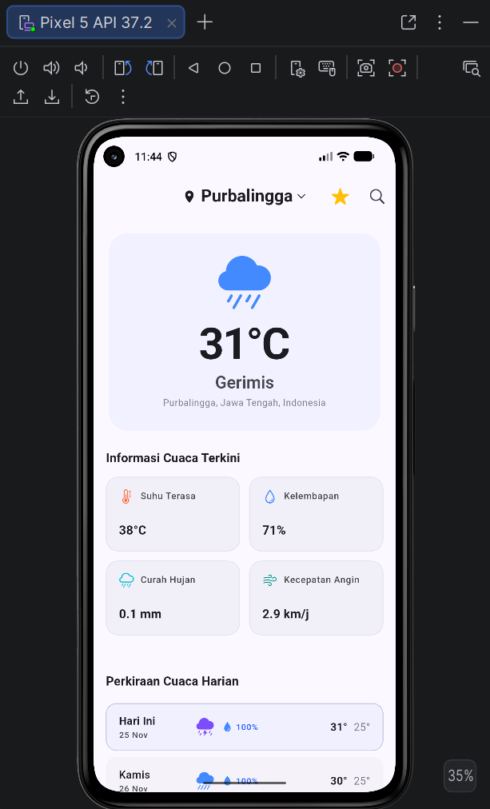
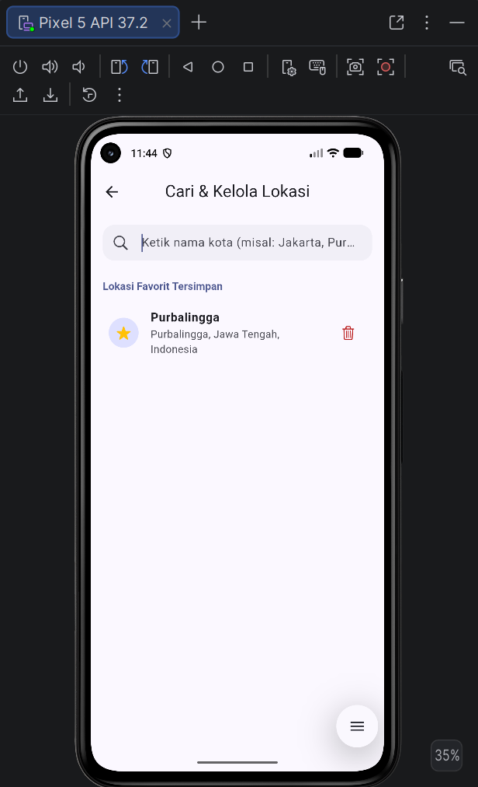

# Responsi Praktikum Pemrograman Mobile - Weather App

Aplikasi ramalan cuaca berbasis Flutter yang mengimplementasikan arsitektur **Model-View-ViewModel (MVVM)**, konsumsi REST API dari **Open-Meteo**, serta persistensi lokal menggunakan **SharedPreferences**.

---

## Antarmuka Aplikasi

| Home Screen (Cuaca & Forecast) | Search Screen & Favorit |
|:---:|:---:|
|  |  |

---

## Pola Arsitektur MVVM

Aplikasi disusun menggunakan pemisahan tanggung jawab (*Separation of Concerns*) berbasis arsitektur MVVM:

```text
lib/
├── models/         # Representasi data & JSON Serialization
│   ├── location_model.dart
│   └── weather_model.dart
├── services/       # Komunikasi HTTP API & Storage
│   ├── weather_service.dart
│   └── storage_service.dart
├── viewmodels/     # State management & bisnis logic (ChangeNotifier)
│   ├── weather_viewmodel.dart
│   └── search_viewmodel.dart
├── views/          # Antarmuka layar aplikasi
│   ├── home_screen.dart
│   ├── search_screen.dart
│   └── widgets/    # Komponen modular reusable
│       ├── weather_info_card.dart
│       └── daily_forecast_item.dart
└── utils/          # Helper WMO Weather Code
    └── weather_helper.dart